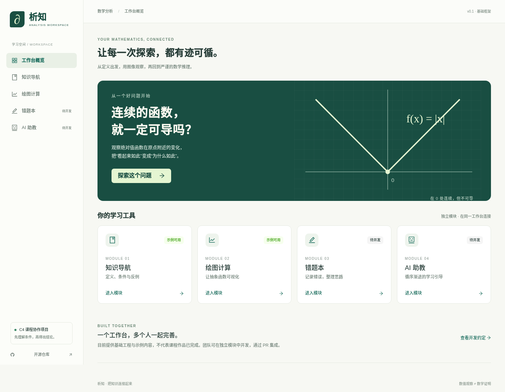

# 数学分析学习工作台 · C4

面向《工科数学分析》数智实践大作业的开源协作项目，将知识导航、绘图计算、错题本、AI 助教等学习功能整合到同一界面。

**当前状态：基础工程与示例流程，非完整课程作品。** 知识导航及绘图提供可运行示例；错题本和 AI 助教为待开发扩展入口。



## 本地启动

使用 `.nvmrc` 指定的 Node.js 22.23.4 与 npm 10.x：

```bash
nvm install
nvm use
npm ci
npm run dev
```

打开终端显示的本地地址。没有 nvm 时安装对应 Node 版本即可。

```bash
npm run check                  # 格式、lint、类型、测试、生产构建
npx playwright install chromium
npm run test:e2e               # 浏览器流程测试
npm run build
npm run preview               # 预览生产包
```

初版无需后端或 API 密钥；构建后须通过 HTTP 服务访问，不支持直接双击 HTML 离线打开。
保存绘图默认设置时会先通过计算 Worker 验证表达式和区间；验证失败不会覆盖原设置。该验证不保证区间内存在可显示的实数值。

## 任务目标

- 选题：C4「数学分析学习工作台」。
- 基础要求：一个统一界面，至少 **2 个功能模块**。
- 专项交付：可用工作台、源代码、设计文档、3–5 分钟演示视频。
- 课程截止日期：2026 年 12 月 5 日；最终以教师通知为准。

任务依据为项目发起人提供的《工科数学分析类课程数智实践大作业》PDF。仓库仅整理需求，不转载任务书原件。

## 模块规划

| 模块     | 目标                                                  | 阶段                               |
| -------- | ----------------------------------------------------- | ---------------------------------- |
| 知识导航 | 3 张结构化示例卡片、筛选搜索、跳转绘图                | 基础示例可用，内容待人工核验与扩充 |
| 绘图计算 | 受限表达式、范围调整、Worker 采样、图表、默认设置保存 | 基础示例可用，尚非符号计算系统     |
| 错题本   | 独立路由与开发说明                                    | 待开发                             |
| AI 助教  | 独立路由与开发说明，不发起模型请求                    | 待开发                             |

技术栈：React + TypeScript + Vite + Ant Design + React Router；mathjs / ECharts / KaTeX / Zod；Vitest / Playwright。
精确依赖版本见 `package.json` 与锁文件。禁止混用框架、包管理器或 UI 库，详见 [团队开发约定](docs/development.md)。

## 扩展功能

每个功能放在 `src/features/<name>/`，复用 `src/shared/` 的契约、计算、存储和公共组件。模块不互相导入内部实现。
新模块注册步骤见 [开发约定](docs/development.md#4-新增功能模块)，跨模块数据见 [接口契约](docs/contracts.md)。
仓库含 PR 自动检查与手动 Pages 发布工作流；尚未配置或验证线上发布，不将仓库链接当成工作台链接。

## 参与贡献

本仓库公开，欢迎所有人 **Fork → 新建分支 → 提交 Pull Request**，无需先成为协作者。PR 经维护者审查后合并；公开贡献不等于直接写入主分支。

详见 [贡献指南](CONTRIBUTING.md)，可从 [待办任务](https://github.com/Lingfengalg/math-analysis-workbench/issues) 认领工作。

## 文档导航

- [C4 需求与验收](docs/requirements.md)
- [设计文档](docs/design.md)
- [团队开发约定](docs/development.md)
- [模块接口契约](docs/contracts.md)
- [实际验证记录](docs/validation.md)
- [课程交付清单](docs/deliverables.md)
- [作品说明模板](docs/templates/project-description.md)
- [AI 使用日志模板](docs/templates/ai-usage.csv)
- [分工与贡献模板](docs/templates/contributions.csv)
- [演示与答辩提纲](docs/templates/presentation.md)

## 数学质量与数据

数学结论须说明适用条件，至少用典型例子与反例验证。图像和数值计算不能替代数学证明。AI 输出须记录并人工核验，不虚构测试结果、纠错案例或成员贡献。

不要提交 API 密钥、同学个人信息、未获授权的教材扫描件或课程资源。

## 许可

本仓库原创代码与文档采用 [MIT License](LICENSE)。第三方材料遵循各自许可，引用时注明来源。
