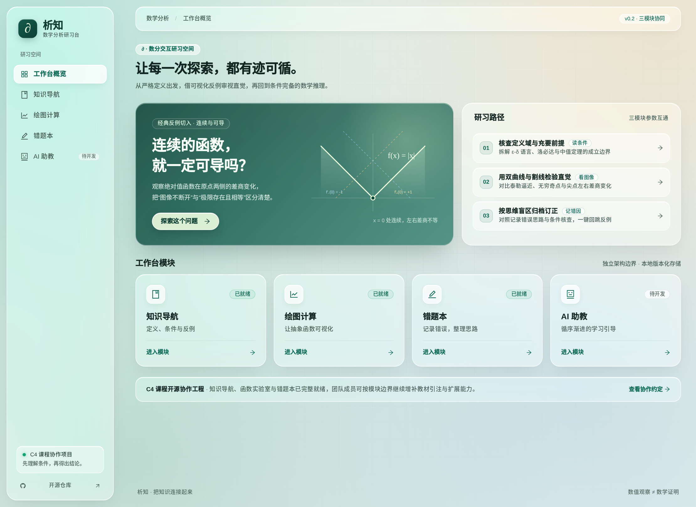

# 数学分析学习工作台 · C4（析知 v1.0）

面向《工科数学分析》数智实践大作业的开源协作项目，将知识导航、三维/二维多元函数与重积分仿真实验室、错题本与 AI 苏格拉底助教整合到同一琉璃毛玻璃工作台界面。

**当前状态：v1.0 四大核心模块全闭环可用（知识导航 ↔ 三模态曲面/重积分仿真实验室 ↔ 错题本 ↔ AI 苏格拉底助教）。** 课程团队提交前仍须对数学内容、教材版次页码与答辩材料完成人工复核。



## 本地启动

使用 `.nvmrc` 指定的 Node.js 22.23.4 与 npm 10.x：

```bash
nvm install
nvm use
npm ci
npm run dev
```

打开终端显示的本地地址。若需启用 AI 助教与真实模型服务对话，在另一终端通过服务端环境变量启动零密钥泄漏本地代理（支持 OpenAI / DeepSeek / 通义千问等兼容接口）：

```bash
AI_API_KEY="your-server-key" npm run dev:proxy
```

质量检查与端到端测试：

```bash
npm run check                  # 格式、lint、类型、测试、生产构建
npx playwright install chromium
npm run test:e2e               # 浏览器端到端流程测试
npm run build
npm run preview                # 预览生产包
```

静态构建包无需后端或 API 密钥即可运行知识导航、三维/二维重积分仿真与错题本；未启动 `dev:proxy` 时 AI 助教诚实展示离线/未配置状态说明，绝不伪造回复。构建后须通过 HTTP 服务访问，不支持直接双击 HTML 离线打开。

## 任务目标

- 选题：C4「数学分析学习工作台」。
- 基础要求：一个统一界面，至少 **2 个功能模块**（当前已完整实现 **4 个核心模块** 并打通跨模块路由上下文联动）。
- 专项交付：可用工作台、源代码、设计文档、3–5 分钟演示视频。
- 课程截止日期：2026 年 12 月 5 日；最终以教师通知为准。

任务依据为项目发起人提供的《工科数学分析类课程数智实践大作业》PDF。仓库仅整理需求，不转载任务书原件。

## 模块状态

| 模块     | 目标与能力                                                                                                                        | 阶段                                 |
| -------- | --------------------------------------------------------------------------------------------------------------------------------- | ------------------------------------ |
| 知识导航 | 5 大数分板块共 18 张上下册结构化卡片（含全微分、拉格朗日乘数、二重/三重积分与格林公式奇点）、全字段检索、关联概念与跨模块联动     | 已就绪，教材精确页码待组员按用书核对 |
| 绘图计算 | 基于 Three.js 的**三模态仿真实验室**：三维多元曲面与二重积分（含 X/Y-型曲边域与极坐标）、三重积分空间体素与截面切片、二维差商     | 已就绪，定位数值仿真而非符号证明系统 |
| 错题本   | 6 类数分错因归档、掌握状态流转、KaTeX 公式预览、6 道上下册典型易错题示例、三维/二维反例与 AI 助教联动、版本化存储与导入导出       | 已就绪                               |
| AI 助教  | 苏格拉底式条件核查引导、知识卡片/错题/绘图上下文挂载、`$...$`/`$$...$$` 公式安全渲染、生成取消及服务端 `server/ai-proxy.mjs` 代理 | 已就绪（密钥仅置于服务端环境变量）   |

技术栈：React + TypeScript + Vite + Ant Design + React Router；Three.js（三维曲面、曲边域黎曼柱体与三重积分体素切片 WebGL 仿真） / mathjs（`mathjs/number` 受限 AST 解析） / KaTeX / Zod；Vitest / Playwright。
精确依赖版本见 `package.json` 与锁文件。禁止混用框架、包管理器或 UI 库，详见 [团队开发约定](docs/development.md)。

## 扩展功能

每个功能放在 `src/features/<name>/`，样式采用 CSS Modules（`<Name>Page.module.css`），复用 `src/shared/` 的契约、计算、存储和公共组件。模块不互相导入内部实现。
新模块注册步骤见 [开发约定](docs/development.md#4-新增功能模块)，跨模块数据见 [接口契约](docs/contracts.md)。
仓库含 PR 自动检查与手动 Pages 发布工作流；尚未配置或验证线上发布，不将仓库链接当成工作台链接。

## 参与贡献

本仓库公开，欢迎所有人 **Fork → 新建分支 → 提交 Pull Request**，无需先成为协作者。PR 经维护者审查后合并；公开贡献不等于直接写入主分支。

详见 [贡献指南](CONTRIBUTING.md)，可从 [待办任务](https://github.com/Lingfengalg/math-analysis-workbench/issues) 认领工作。

## 文档导航

- [C4 需求与验收](docs/requirements.md)
- [设计文档](docs/design.md)
- [团队开发约定](docs/development.md)
- [模块接口契约](docs/contracts.md)
- [实际验证记录](docs/validation.md)
- [课程交付清单](docs/deliverables.md)
- [作品说明模板](docs/templates/project-description.md)
- [AI 使用日志模板](docs/templates/ai-usage.csv)
- [分工与贡献模板](docs/templates/contributions.csv)
- [演示与答辩提纲](docs/templates/presentation.md)

## 数学质量与数据

数学结论须说明适用条件，至少用典型例子与反例验证。图像、三维黎曼柱体/体素和数值差商观察不能替代严格数学证明。AI 输出须记录并人工核验，不虚构测试结果、纠错案例或成员贡献。

不要提交 API 密钥、同学个人信息、未获授权的教材扫描件或课程资源。

## 许可

本仓库原创代码与文档采用 [MIT License](LICENSE)。第三方材料遵循各自许可，引用时注明来源。
