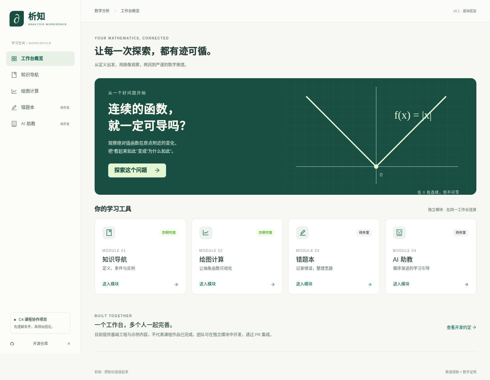

# 数学分析学习工作台 · C4

面向《工科数学分析》数智实践大作业的开源协作项目，将知识导航、绘图计算、错题本、AI 助教等学习功能整合到同一界面。

**当前状态：基础工程与示例流程，非完整课程作品。** 知识导航、绘图计算与本地错题本提供可运行功能；AI 助教仍为待开发扩展入口。



## 本地启动

使用 `.nvmrc` 指定的 Node.js 22.23.4 与 npm 10.x：

```bash
nvm install
nvm use
npm ci
npm run dev
```

打开终端显示的本地地址。没有 nvm 时安装对应 Node 版本即可。

```bash
npm run check                  # 格式、lint、类型、测试、生产构建
npx playwright install chromium
npm run test:e2e               # 浏览器流程测试
npm run build
npm run preview               # 预览生产包
```

初版无需后端或 API 密钥；构建后须通过 HTTP 服务访问，不支持直接双击 HTML 离线打开。
保存绘图默认设置时会先通过计算 Worker 验证表达式和区间；验证失败不会覆盖原设置。该验证不保证区间内存在可显示的实数值。
无法读取的本地默认设置不会被保存操作覆盖；备份后可在页面确认清除并重新保存。

## 任务目标

- 选题：C4「数学分析学习工作台」。
- 基础要求：一个统一界面，至少 **2 个功能模块**。
- 专项交付：可用工作台、源代码、设计文档、3–5 分钟演示视频。
- 课程截止日期：2026 年 12 月 5 日；最终以教师通知为准。

任务依据为项目发起人提供的《工科数学分析类课程数智实践大作业》PDF。仓库仅整理需求，不转载任务书原件。

## 模块规划

| 模块     | 目标                                                                                          | 阶段                               |
| -------- | --------------------------------------------------------------------------------------------- | ---------------------------------- |
| 知识导航 | 3 张结构化示例卡片、主题筛选与全文搜索（含条件/例题/误区）、跳转绘图                          | 基础示例可用，内容待人工核验与扩充 |
| 绘图计算 | 受限表达式、范围调整、Worker 采样、自适应间断点检测、图表、默认设置保存、数据摘要与无障碍替代 | 基础示例可用，尚非符号计算系统     |
| 错题本   | 本地增删改查、示例练习、重做反馈、主题与复习筛选、JSON 导入导出、损坏数据保护                 | 基础可用，无账号或云同步           |
| AI 助教  | 独立路由与开发说明，不发起模型请求                                                            | 待开发                             |

技术栈：React + TypeScript + Vite + Ant Design + React Router；mathjs / ECharts / KaTeX / Zod；Vitest / Playwright。
精确依赖版本见 `package.json` 与锁文件。禁止混用框架、包管理器或 UI 库，详见 [团队开发约定](docs/development.md)。

## 扩展功能

每个功能放在 `src/features/<name>/`，复用 `src/shared/` 的契约、计算、存储和公共组件。模块不互相导入内部实现。
新模块注册步骤见 [开发约定](docs/development.md#4-新增功能模块)，跨模块数据见 [接口契约](docs/contracts.md)。

知识导航的「导数」主题提供差商互动实验：可选择二次函数或绝对值函数，通过滑块或拖动图上的点调整观察点和增量，观察割线、切线与斜率，并完成一道概念自测。实验使用 [JSXGraph](https://github.com/jsxgraph/jsxgraph)；图像和有限次数值观察不是证明，实验仅使用两个固定例子的解析导数，不是通用符号计算器。

「极限」主题新增左右逼近互动动画：以 x² 在 1 附近和 x/|x| 在 0 附近为两个固定场景，对照左右函数值。可播放、暂停、手动调节及重置；离开页面或切到后台会停止播放，系统启用减少动态效果时可改用滑块。动画不会让点真正到达目标，SVG 按钮导出当前的静态画面而非视频。图像与有限次观察不能代替极限证明。场景使用 JSXGraph 绘图及 [Tween.js](https://github.com/tweenjs/tween.js) 控制插值。

绘图主表达式和练习中的数字题可选用 [MathLive](https://github.com/arnog/mathlive) 数学编辑器输入分数、幂等公式；点击「打开数学编辑器」开始，原文本输入仍可使用。编辑器从空白开始，预览转换结果后需主动点击「替换原输入」；绘图表达式会先通过原有 Worker 计算白名单校验。只支持明确允许的一部分数学记号，积分、下标等不能转写；练习答案仍限定为整数、小数或整数分数。未知或不完整的公式不会覆盖原输入，取消也不会改变原输入。编辑器和字体由本地构建提供，不依赖 CDN；当前并非通用 LaTeX 或符号求解器。

### 错题本使用说明

进入「错题本」后可记录题目、知识主题、题目内容、错误原因与订正；列表支持按主题筛选、关键词搜索、编辑与删除（删除前需二次确认）。
数据通过 `shared/storage` 写入当前浏览器的 `localStorage`（键 `math-workbench:mistakes`），当前键版本为 2，最多 200 条；可读取旧版版本 1，下一次写入后保存为版本 2：
换浏览器、清站点数据或使用隐私模式不会保留记录，也没有账号、跨设备同步或真实个人信息。
数据损坏或版本不兼容时页面只提示并保留原始内容，不会静默覆盖；写入失败（如配额不足）时保留当前列表并提示原因。
同时打开多个标签页时，各页通过 `storage` 事件同步，写入基于最新数据合并，不会互相覆盖；编辑其他标签页已删除的记录会提示冲突。

错题如果标记为极限、连续或导数，可通过「查看相关知识」进入知识导航的对应主题；「其他」主题不提供该入口。链接只传递主题，不包含错题内容。 知识卡片也可打开对应主题的错题列表，记录新错题时默认选中该主题。

#### 示例练习与重做

从错题本的「开始练习」或导数互动实验进入示例练习。当前提供 4 道原创示例题，覆盖极限、连续和导数，题目内容仍需课程团队审核与扩充。系统使用 Khan Academy 开源的 Perseus 评分模块为固定答案的数字题和单选题评分，展示提示、解析及最近作答情况。数字题目前只接受整数、小数和分数，不支持任意表达式或通用符号等价判断。

答错时自动关联一条本地错题；重新答对后将关联错题标为已复习。如果记录已保存但错题同步失败，页面提供「同步最近结果」重试；题目内容被用户修改后不自动覆盖。已有自由文本错题可以点击「重做」：先自行作答再显示原订正，由学习者自评是否掌握；重做输入不会保存，也不自动判分。

练习记录和错题是两份独立的本地数据。练习页提供单独的 JSON 导出、合并导入和确认清除，最多保存 2000 次作答；原有错题的导入导出不会包含练习记录，反之亦然。导入练习记录不会自动更改错题复习状态，可使用同步最近结果。数据损坏时保留原始内容并可导出供手工恢复；原始损坏文件不保证可以直接导入。

#### 导出与导入

- 「导出 JSON」把全部错题及复习计划导出为 `mistakes-YYYY-MM-DD.json`，格式标识为 `math-analysis-workbench/mistakes`、版本 2，含导出时间；导出在本地完成，不发起网络请求。导入兼容原有版本 1。
- 「导入」选择上述 JSON 文件后可二选一：**合并**（按 `id` 去重，保留 `updatedAt` 较新的一条）或**替换**（清空后导入）。
- 非法 JSON、格式或版本不符、字段缺失、文件内 `id` 重复、导入后超过 200 条都会给出明确错误，且不改动现有数据。
- 合并导入时如果无计划的旧记录将覆盖已有计划，整次导入会被拒绝；替换导入仍会按用户明确选择替换全部错题及计划。

#### 复习标记

每条错题可标记「已复习」（记录最近复习时间）或取消标记；列表支持按「全部 / 未复习 / 已复习」筛选，可与主题筛选、关键词搜索叠加。
标记不改变创建时间，但会更新最近更新时间，因此列表顺序会随复习操作变化。

#### FSRS 复习计划

错题本显示当前待复习数量、最近到期时间和每题下次复习时间，点击「开始复习」可重做待复习错题。新错题及旧版未建立计划的错题视为待复习；旧的「已复习」标记不作为虚构评分迁入。

重做后自评「仍需复习 / 有困难 / 已掌握 / 很轻松」，分别对应 FSRS 的 Again / Hard / Good / Easy。系统通过 `ts-fsrs` 5.4.2 的 FSRS-6 调度器，根据每题卡片状态和本次评分计算下次时间；默认目标保持率为 90%，未进行个人参数训练。计划保存在错题内并随错题导出，页面打开时按本地时间显示到期情况，不提供后台推送或跨设备同步。普通的「标记已复习」以及示例题自动判分不会自动产生 FSRS 评分或改变已安排的时间，需通过重做自评更新计划。
仓库含 PR 自动检查与手动 Pages 发布工作流；尚未配置或验证线上发布，不将仓库链接当成工作台链接。

## 参与贡献

本仓库公开，欢迎所有人 **Fork → 新建分支 → 提交 Pull Request**，无需先成为协作者。PR 经维护者审查后合并；公开贡献不等于直接写入主分支。

详见 [贡献指南](CONTRIBUTING.md)，可从 [待办任务](https://github.com/Lingfengalg/math-analysis-workbench/issues) 认领工作。

## 文档导航

- [C4 需求与验收](docs/requirements.md)
- [设计文档](docs/design.md)
- [团队开发约定](docs/development.md)
- [模块接口契约](docs/contracts.md)
- [实际验证记录](docs/validation.md)
- [性能基线](docs/performance.md)
- [课程交付清单](docs/deliverables.md)
- [作品说明模板](docs/templates/project-description.md)
- [AI 使用日志模板](docs/templates/ai-usage.csv)
- [分工与贡献模板](docs/templates/contributions.csv)
- [演示与答辩提纲](docs/templates/presentation.md)

## 数学质量与数据

数学结论须说明适用条件，至少用典型例子与反例验证。图像和数值计算不能替代数学证明。AI 输出须记录并人工核验，不虚构测试结果、纠错案例或成员贡献。

不要提交 API 密钥、同学个人信息、未获授权的教材扫描件或课程资源。

## 许可

本仓库原创代码与文档采用 [MIT License](LICENSE)。第三方材料遵循各自许可，引用时注明来源。

JSXGraph 采用 MIT 或 LGPL-3.0-or-later 双许可，本项目选择 MIT；上游版权与许可文本见 [第三方许可](public/third-party-notices/JSXGraph-MIT.txt)。
练习评分使用 Khan Academy 的 [Perseus](https://github.com/Khan/perseus) 中 `@khanacademy/perseus-score`，采用 MIT 许可；其上游及相关依赖许可文本保存在 [第三方许可目录](public/third-party-notices/)。题目内容为本项目原创，未从 Perseus 复制。
间隔复习使用 [ts-fsrs](https://github.com/open-spaced-repetition/ts-fsrs)（MIT），许可文本见 [ts-fsrs 许可](public/third-party-notices/ts-fsrs-MIT.txt)。
数学输入使用 [MathLive](https://github.com/arnog/mathlive)（MIT），许可文本见 [MathLive 许可](public/third-party-notices/mathlive-MIT.txt)。
公式字体与 KaTeX 组件的许可分别见 [KaTeX 字体许可](public/third-party-notices/KaTeX-fonts-MIT.txt) 和 [KaTeX 许可](public/third-party-notices/KaTeX-MIT.txt)。
Tween.js 采用 MIT 许可，许可文本见 [Tween.js 许可](public/third-party-notices/tweenjs-MIT.txt)。
